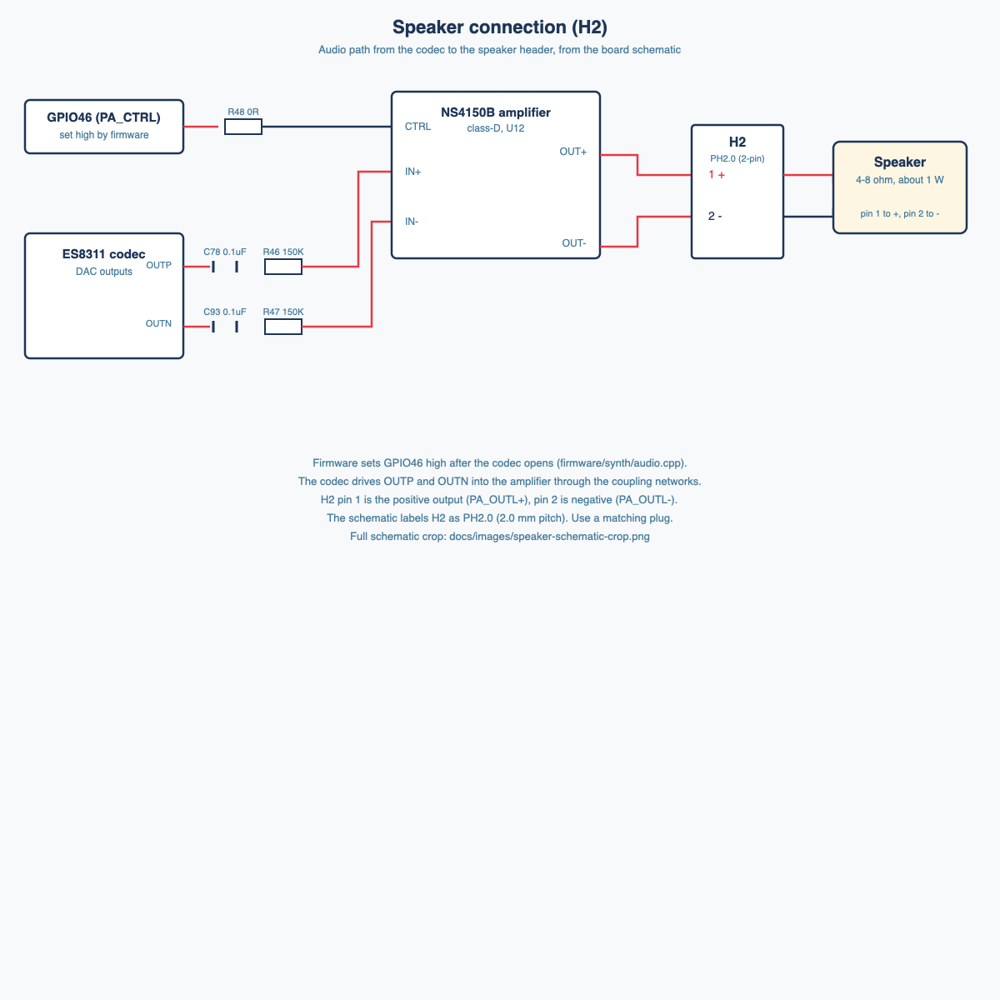

# ESP Synth

A 4-oscillator synthesizer on the Waveshare ESP32-S3-RLCD-4.2 (4.2" reflective LCD, ESP32-S3, ES8311 codec). It plays through the onboard amplifier and speaker and is controlled by buttons, potentiometers, a sync input, a serial command set, and a browser panel.



## Features

- **4 oscillators** playing at the same time, each with its own waveform, level, detune, and on/off state.
- **Three waveforms**: sawtooth, square, and triangle.
- **Pitch**: musical notes (C1 to C7) or raw Hz, switchable.
- **Sync**: phase reset on a rising edge (5 V input, conditioned to 3.3 V), or tempo sync, where the oscillator frequency follows the input clock at x0.25, x0.5, x1, x2, or x4.
- **Hardware controls**: two onboard buttons (KEY and BOOT) and three potentiometers. Pots use soft takeover, so switching voices does not make them jump.
- **Display**: a 400 x 300 screen with four voice tiles showing the waveform, note or Hz, detune, level, and sync state.
- **Serial command set** over USB, for testing and automation (`status`, `note`, `wave`, `level`, `detune`, `free`, `sync`, `pitch`, `pots`, `audio`, `codec`, and more). Run `help` on the board.
- **Browser control panel** (`firmware/ui/index.html`) using the Web Serial API: on-screen keyboard and computer keys, up to four notes at once, and per-voice controls.

## Hardware

- Waveshare ESP32-S3-RLCD-4.2 board (ESP32-S3-WROOM-1-N16R8, 16 MB flash, 8 MB PSRAM)
- Three 10k linear potentiometers on the P1 header (GPIO1, GPIO2, GPIO3)
- Optional sync input on GPIO17 with a 1k / 10k / 20k divider and a clamp diode
- A 4-8 ohm, about 1 W speaker on the H2 connector (PH2.0 in the schematic)

Wiring diagrams are in [docs/controls-and-sync.md](docs/controls-and-sync.md) and [docs/audio.md](docs/audio.md). The breadboard layout is in [docs/images/breadboard-layout.png](docs/images/breadboard-layout.png).

## Quick start

1. Install the Arduino ESP32 core 3.3.1 and the U8g2 library:
   ```sh
   arduino-cli core install esp32:esp32@3.3.1
   arduino-cli lib install U8g2
   ```
2. Build and upload (see [firmware/README.md](firmware/README.md) for the board options):
   ```sh
   arduino-cli compile --fqbn "esp32:esp32:esp32s3:CDCOnBoot=cdc,FlashMode=qio,FlashSize=16M,PartitionScheme=app3M_fat9M_16MB,PSRAM=opi" --libraries firmware/libraries firmware/synth
   arduino-cli upload -p /dev/cu.usbmodemXXXX --fqbn "esp32:esp32:esp32s3:CDCOnBoot=cdc,FlashMode=qio,FlashSize=16M,PartitionScheme=app3M_fat9M_16MB,PSRAM=opi" firmware/synth
   ```
3. Try a command:
   ```sh
   python3 firmware/tools/synth_cmd.py /dev/cu.usbmodemXXXX "note 1 69" "on 1"
   ```
4. Or open the browser panel: `cd firmware/ui && python3 -m http.server 8000`, then open http://localhost:8000 in Chrome or Edge and click **Connect board**.

Host tests (no hardware needed): `firmware/test/host/run.sh`

## Project layout

| Path | Contents |
|---|---|
| `firmware/synth/` | Arduino sketch: engine, input logic, controls, display, audio, serial commands |
| `firmware/libraries/waveshare_rlcd/` | Vendored Waveshare display and codec drivers (Apache-2.0) |
| `firmware/ui/` | Browser control panel |
| `firmware/tools/` | Serial helper script |
| `firmware/test/host/` | Host tests for the engine and logic |
| `docs/` | Pinout, audio path, controls and sync wiring, diagrams, datasheets, schematics |
| `description.md` | Original project description and design sketch |

## Status

- Firmware builds with arduino-cli (ESP32 core 3.3.1). It uses 14% of flash and 7% of RAM.
- Host tests pass.
- Verified on the board: boot, codec init, serial commands, amplifier enable (GPIO46).
- Still to verify by ear: a clean sound through the speaker with the latest build.

## Next features

### Effects (planned)

Firmware has no effects yet. These are planned, in this order of work:

1. **Low-pass filter**: resonant filter, cutoff and resonance per voice or on the mix.
2. **Tremolo / LFO**: amplitude wobble at a set rate and depth. This LFO is shared with vibrato.
3. **Vibrato**: pitch wobble from the same LFO.
4. **Delay / echo**: feedback delay on the mix, using a buffer in PSRAM (about 1 s fits).
5. **Phaser**: all-pass stages swept by an LFO.
6. **Slicer**: rhythmic gating of the output, timed by the tempo clock.

Control: the browser panel for now. The three pots keep their current jobs (frequency, level, detune on the selected voice). Adding pot control of effects is a later step.

### Other ideas

- Band-limited (anti-aliased) saw and square oscillators.
- A line-out jack (needs a buffer stage and a jack; see [docs/audio.md](docs/audio.md)).
- Lock-free voice state between the main loop and the audio task.

## License

The Waveshare drivers in `firmware/libraries/waveshare_rlcd/` are Apache-2.0 (see the LICENSE file there). The rest of the project has no license yet.
