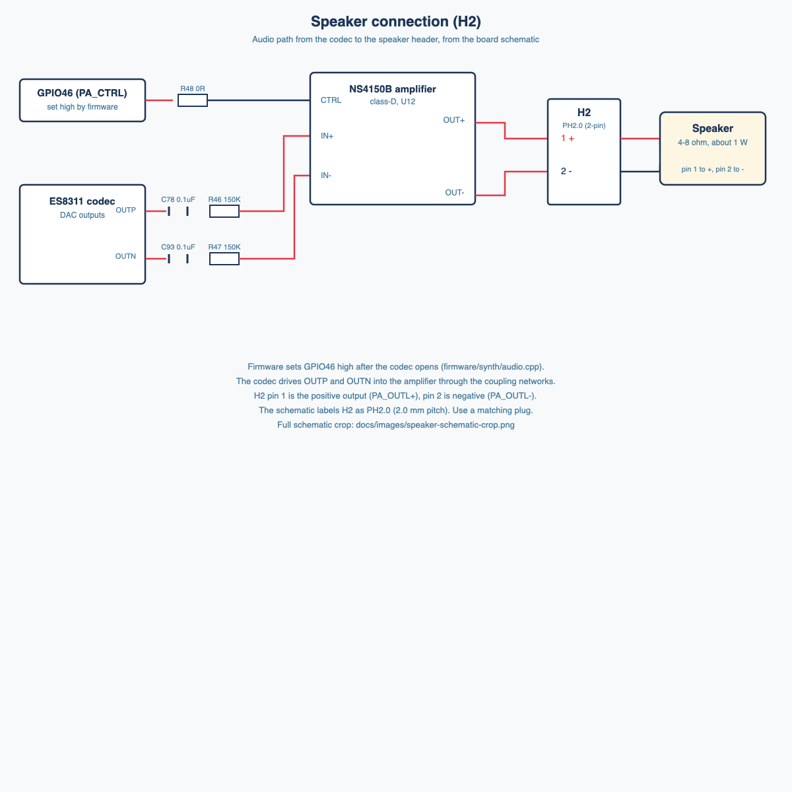
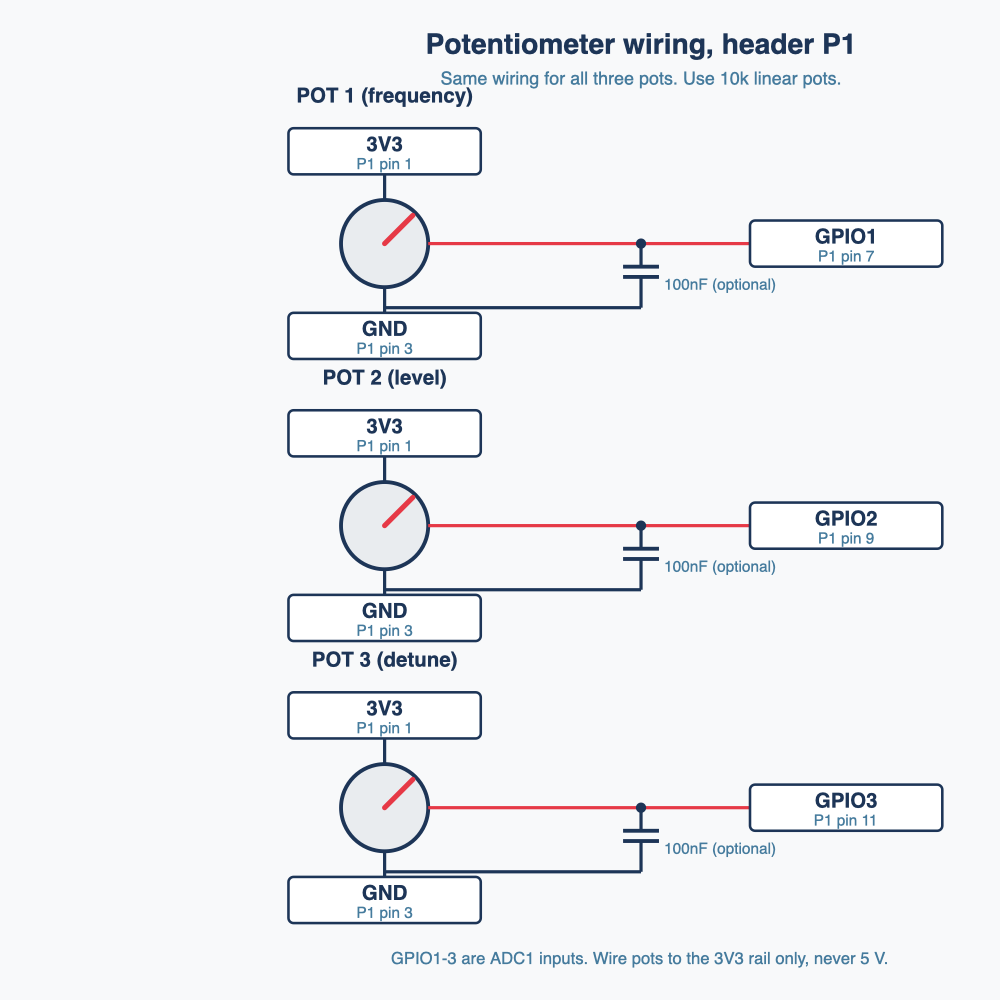
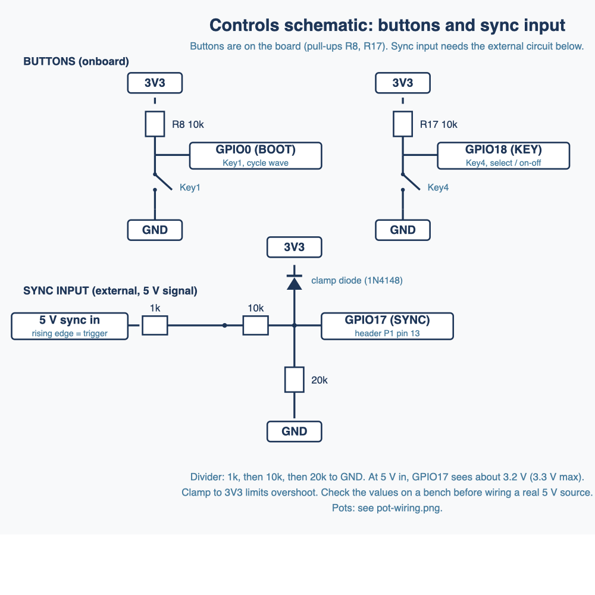
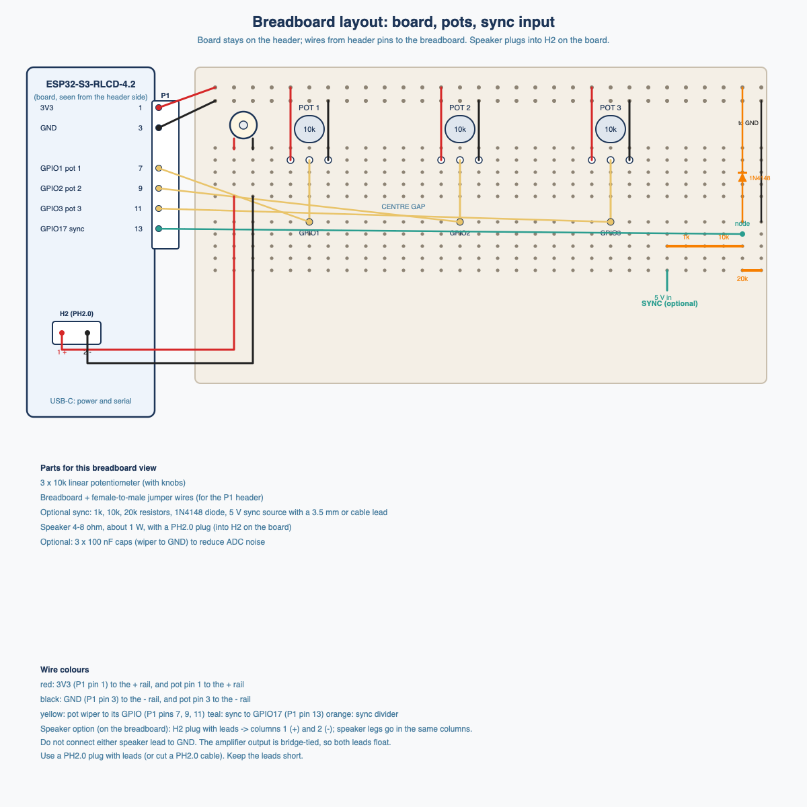

# ESP32-S3-RLCD-4.2 project docs

Reference material for the synth build on the Waveshare ESP32-S3-RLCD-4.2 board. Collected 2026-11-11.

## Diagrams

## Contents

| File | What it covers |
|---|---|
| [pinout.md](pinout.md) | Every ESP32-S3 GPIO: what the board uses it for, and whether it is free |
| [audio.md](audio.md) | Speaker path (ES8311 codec, amplifier, speaker header) and the line-out option |
| [controls-and-sync.md](controls-and-sync.md) | Buttons, pots, and the 5 V sync input wiring |
| [hardware/ESP32-S3-RLCD-4.2-schematic.pdf](hardware/ESP32-S3-RLCD-4.2-schematic.pdf) | Full board schematic (single page) |
| [hardware/ESP32-S3-RLCD-4.2-mechanical.pdf](hardware/ESP32-S3-RLCD-4.2-mechanical.pdf) | Mechanical drawing with dimensions |
| [hardware/ESP32-S3-RLCD-4.2-mechanical.dxf](hardware/ESP32-S3-RLCD-4.2-mechanical.dxf) | Mechanical CAD (for enclosure work) |
| [datasheets/ES8311.pdf](datasheets/ES8311.pdf) | Audio codec datasheet |
| [datasheets/ST7305.pdf](datasheets/ST7305.pdf) | Display controller datasheet |

## Sources

- Product docs: https://docs.waveshare.com/ESP32-S3-RLCD-4.2
- Resources page (schematic, datasheets, demo code): https://docs.waveshare.com/ESP32-S3-RLCD-4.2/Resources-And-Documents
- Schematic: https://files.waveshare.com/wiki/ESP32-S3-RLCD-4.2/ESP32-S3-RLCD-4.2-schematic.pdf
- Mechanical zip (PDF + DXF + STP): https://files.waveshare.com/wiki/ESP32-S3-RLCD-4.2/ESP32-S3-RLCD-4.2_20261010.zip
- Demo code: https://github.com/waveshareteam/ESP32-S3-RLCD-4.2

The STEP file from the mechanical zip (24 MB) is not copied into the repo. Download it from the zip above if needed.

## Board notes

- The product page says V2 boards start shipping 2026-10-10. The acrylic spacer is thicker (4.35 mm vs 3.75 mm), so the total thickness changes from 13.50 mm to 14.1 mm. Check the QC label on the board. Measure your unit before designing an enclosure.
- Module: ESP32-S3-WROOM-1-N16R8 (16 MB flash, 8 MB PSRAM).
- Display: 4.2" reflective LCD, 300 x 400, driven by ST7305.
