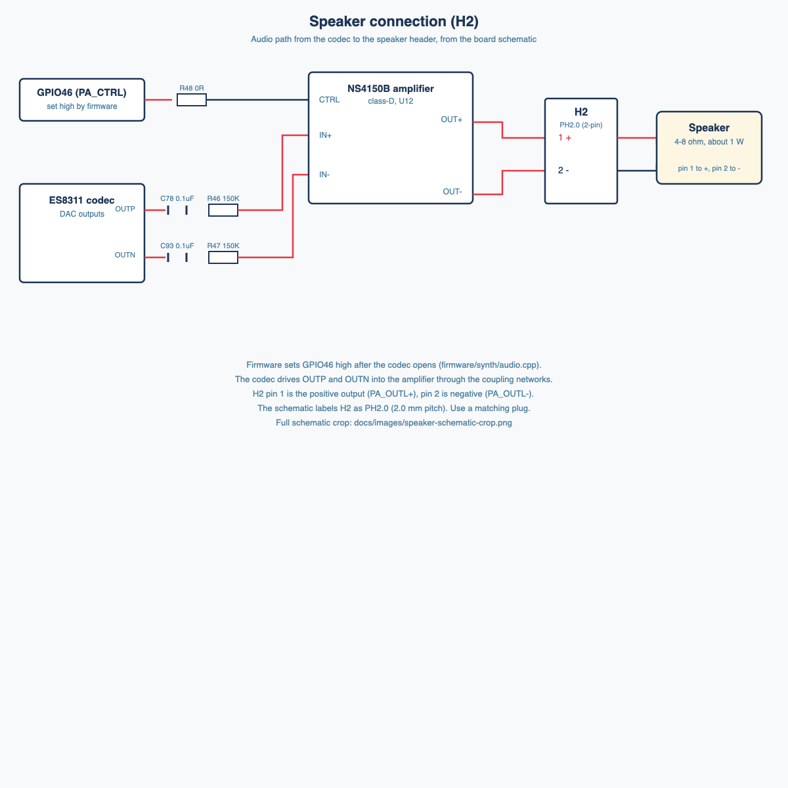

# Audio path

Source: schematic sections "Codec PA&SPEAKER&MIC" and "POWER Supply", and the [ES8311 datasheet](datasheets/ES8311.pdf).

## Signal chain (speaker, v1)

```
ESP32-S3 I2S --> ES8311 codec (U9) --> OUTP/OUTN differential --> NS4150B amplifier (U12) --> H2 speaker (PH2.0, 2-pin)
                                                                       ^
                                                              PA_CTRL (GPIO46) enables amp
```

## ESP32 to ES8311 connections

| Signal | GPIO | ES8311 pin |
|---|---|---|
| MCLK | GPIO16 | MCLK |
| SCLK (bit clock) | GPIO9 | SCLK |
| LRCK (word select) | GPIO45 | LRCK |
| DSDIN (audio to codec) | GPIO8 | DSDIN |
| ASDOUT (audio from codec) | GPIO10 | ASDOUT |

Codec control goes over the shared I2C bus (GPIO13 SDA, GPIO14 SCL). The codec's CE pin is pulled through R25 (10k) and I see no GPIO control for it in the schematic. Check the ES8311 datasheet for its I2C address and register init sequence.

## Speaker

- Connector H2 is a 2-pin header. The schematic labels it PH2.0 (2.0 mm pitch). The product docs say MX1.25, which conflicts; check the plug on your board. 



Source: [images/speaker-connection.svg](images/speaker-connection.svg). Full schematic crop: [images/speaker-schematic-crop.png](images/speaker-schematic-crop.png).
- The amp is an NS4150B. Its CTRL pin is driven from PA_CTRL (GPIO46). The codec driver does not raise it on this board, so firmware sets GPIO46 high explicitly after the codec opens (firmware/synth/audio.cpp).
- The speaker output is differential (OUTP/OUTN into the amp), so a speaker should be connected across the two H2 pins.

## Line out (later, not designed)

The board has no line-out jack. The codec's OUTP/OUTN nets feed the amplifier input network, so a line out would need:

1. A tap from OUTP/OUTN before the amp.
2. DC-blocking capacitors.
3. Level and drive suitable for a line-level input (a buffer or op-amp stage is typical).
4. A 3.5 mm or 6.35 mm jack.

Not designed yet. Decide before layout if line out is needed in v1.

## Other audio parts on the board

- ES7210 (ADC) with dual microphones. Not needed for the synth.
- AEC circuitry for echo cancellation. Not needed.
