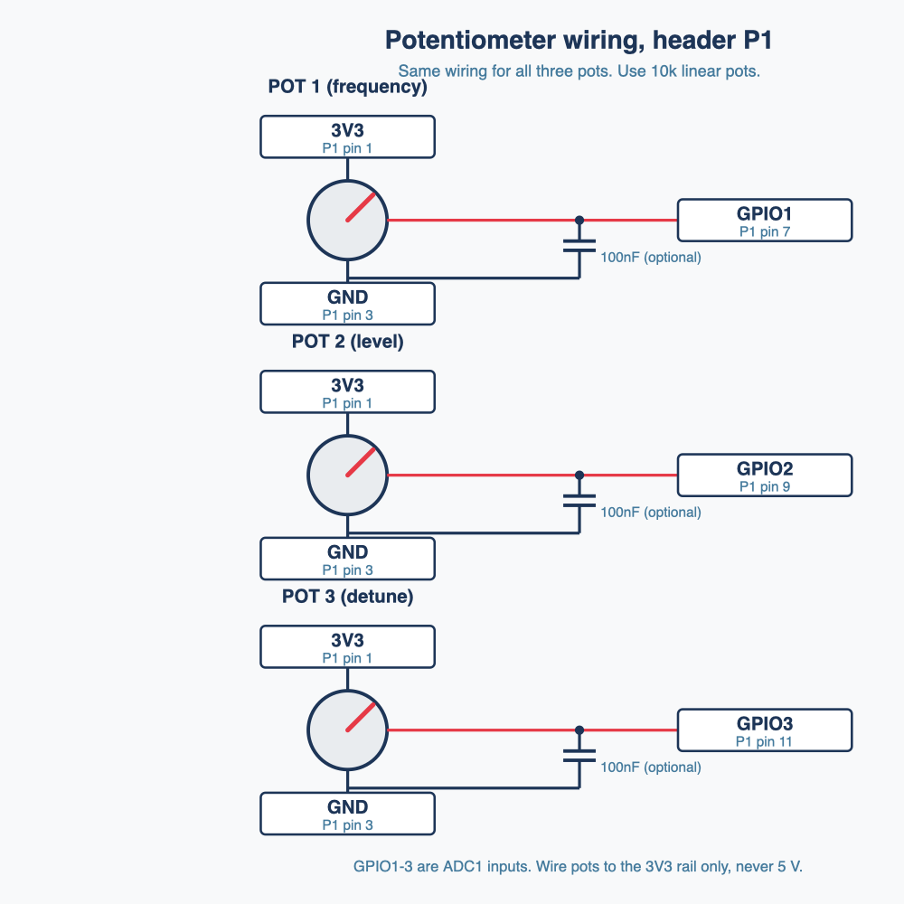
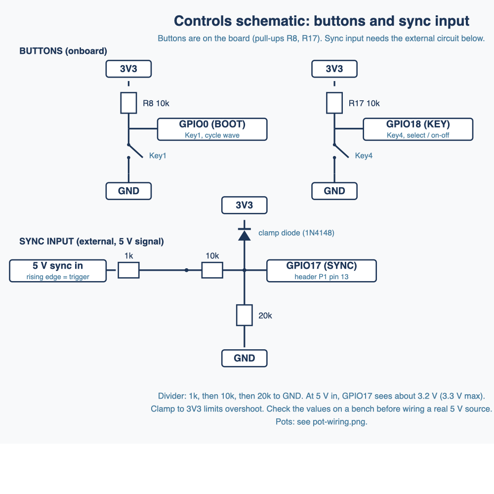
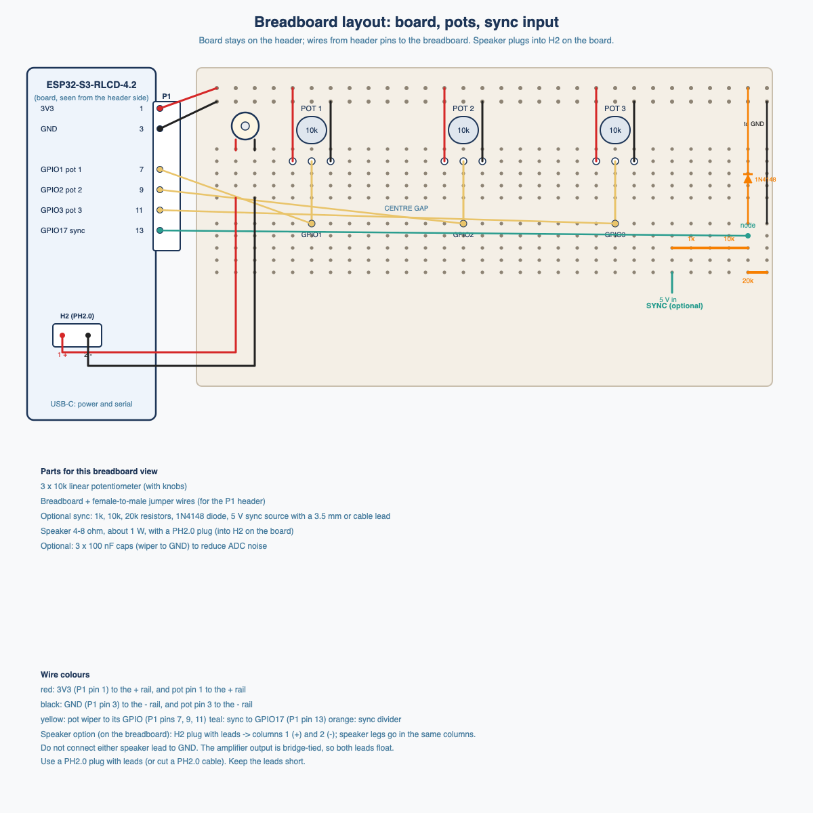

# Controls and sync wiring

Pin numbers are from [pinout.md](pinout.md). The sync conditioning values are a starting point. Verify against the datasheet and bench-test before connecting a real 5 V source.

## Diagrams

### Pot wiring



Source: [images/pot-wiring.svg](images/pot-wiring.svg)

### Buttons and sync input



Source: [images/controls-schematic.svg](images/controls-schematic.svg)

### Breadboard layout



Source: [images/breadboard-layout.svg](images/breadboard-layout.svg)

## Buttons

| Button | GPIO | Board hardware | Planned use |
|---|---|---|---|
| Key1 (BOOT) | GPIO0 | Pulled up on board | Cycle waveform |
| Key4 (KEY) | GPIO18 | Pulled up by 10k (R17) | Short press: select next oscillator. Long press: toggle active. |
| Key3 (PWR, per schematic) | n/a | Power switch circuit, not a GPIO | Not usable |

Both buttons are pulled up on the board, so connect them to GND when pressed. No external pull-up is needed.

## Potentiometers (3, external)

| Pot | GPIO | Controls (selected oscillator) |
|---|---|---|
| Pot 1 | GPIO1 (ADC1) | Frequency |
| Pot 2 | GPIO2 (ADC1) | Level |
| Pot 3 | GPIO3 (ADC1) | Detune |

Wiring: one end to VCC3V3 (P1 pin 1), other end to GND (P1 pin 3), wiper to the GPIO.

Notes:
- The ESP32-S3 ADC is noisy. Use a 100 nF capacitor from each wiper to GND, and average several reads in firmware.
- Pot resistance around 10k is a common choice.

## Sync input (5 V, conditioned)

Input on GPIO17 (header P1 pin 13). The ESP32-S3 GPIO is 3.3 V, so the 5 V sync signal needs conditioning.

Suggested circuit (starting point):

```
sync in (5 V) ---[ 1k series ]---+---> GPIO17
                                 |
                              [ 10k ]
                                 |
                                 +---[ 20k ]--- GND
                                 |
                  clamp: diode from GPIO17 node to 3V3 (e.g., 1N4148 or BAT54)
```

- The divider gives about 3.3 V at 5 V in (20k / 30k x 5 V = 3.33 V). That is at the 3.3 V rail, so the clamp to 3V3 protects against overshoot.
- The 1k series resistor limits current into the clamp.
- Firmware: detect rising edges with an interrupt, and debounce if needed.

Mode A (v1): reset oscillator phases on each rising edge.
Mode B (later): tempo sync, where frequency follows the incoming clock.

Open: confirm the sync source's output impedance and whether it is a true 0-5 V square wave or a pulse with a different duty cycle. Adjust the divider if needed.
